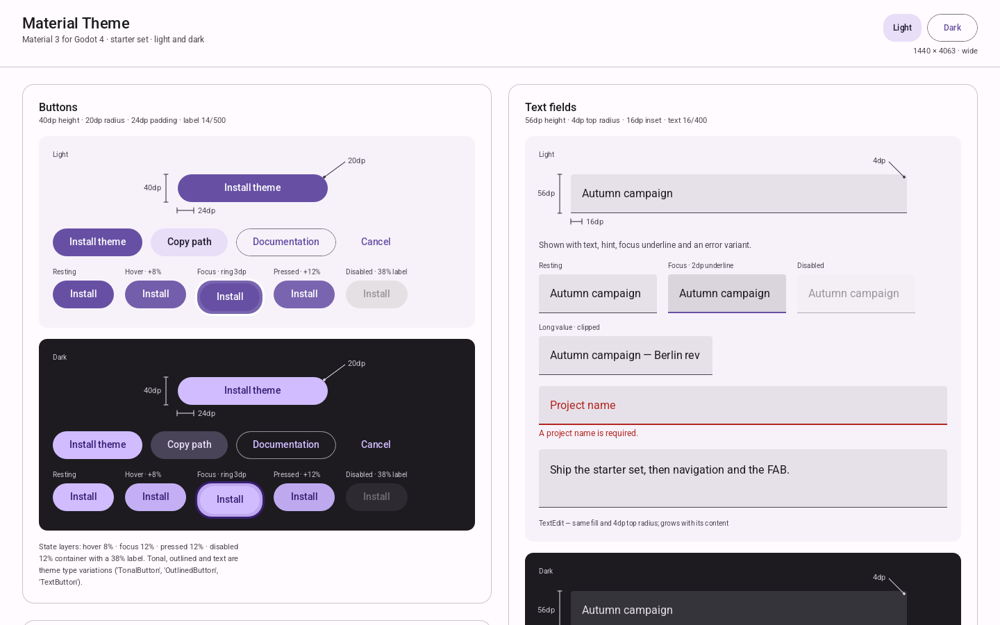
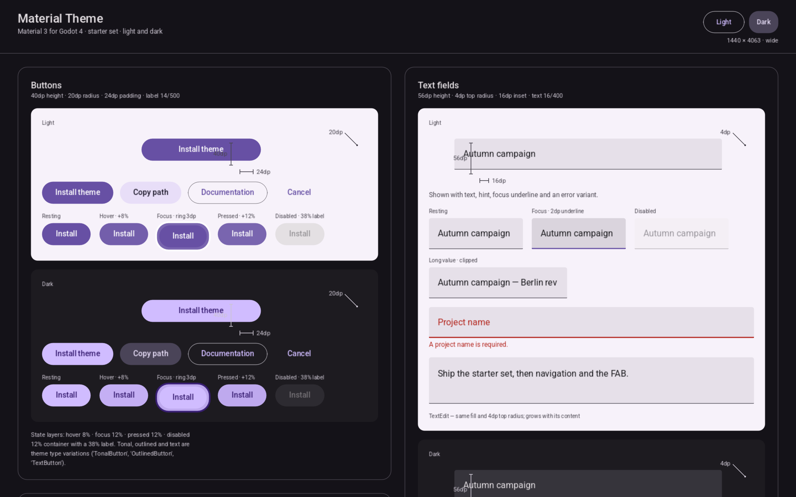
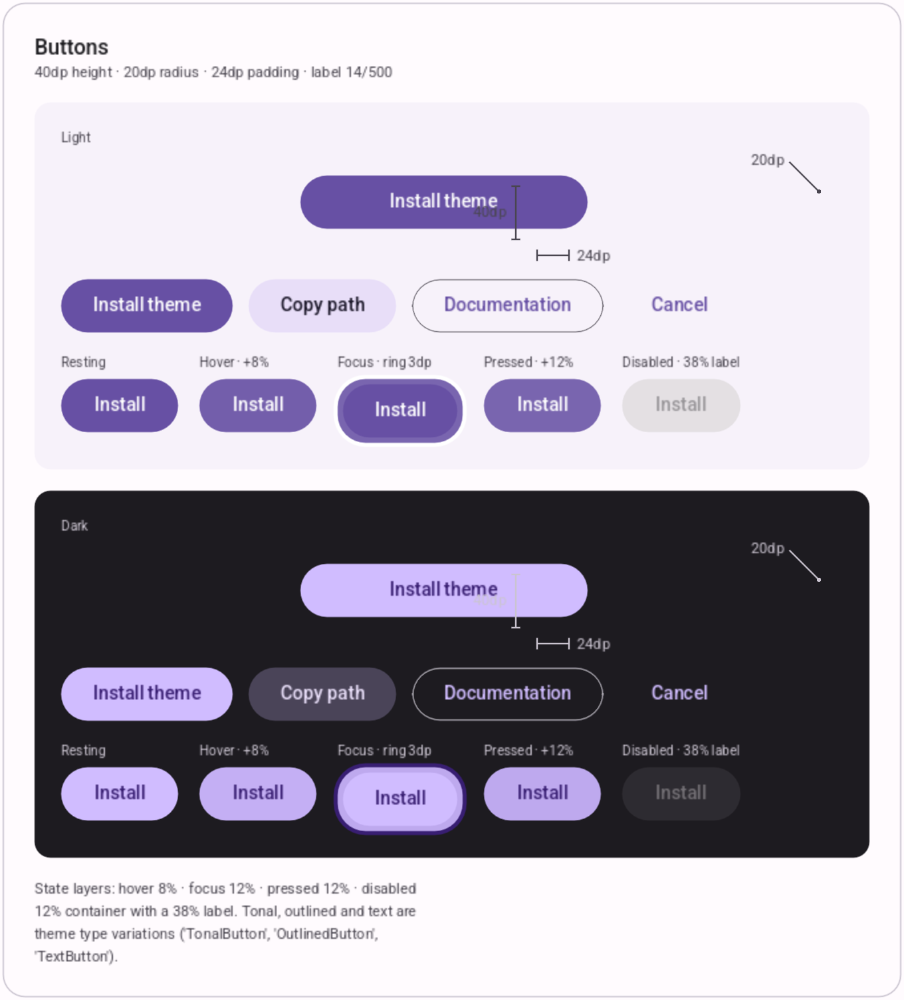
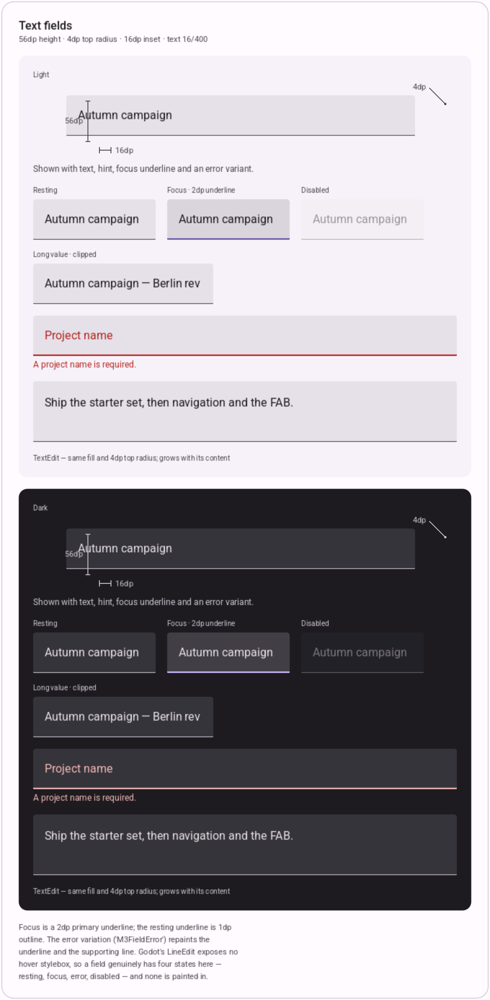
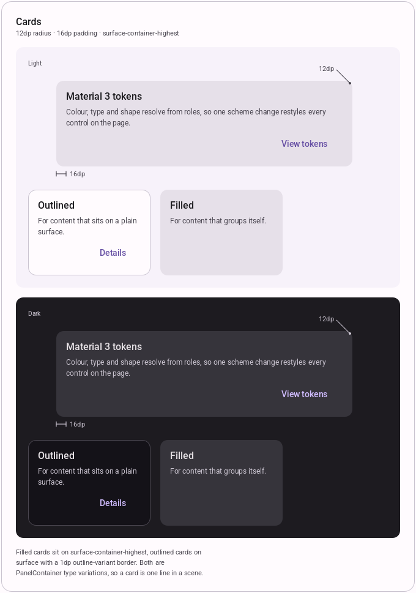
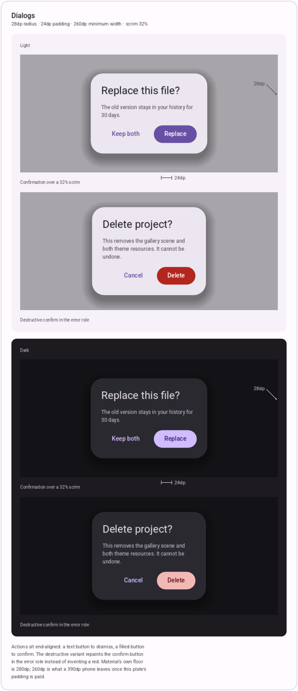
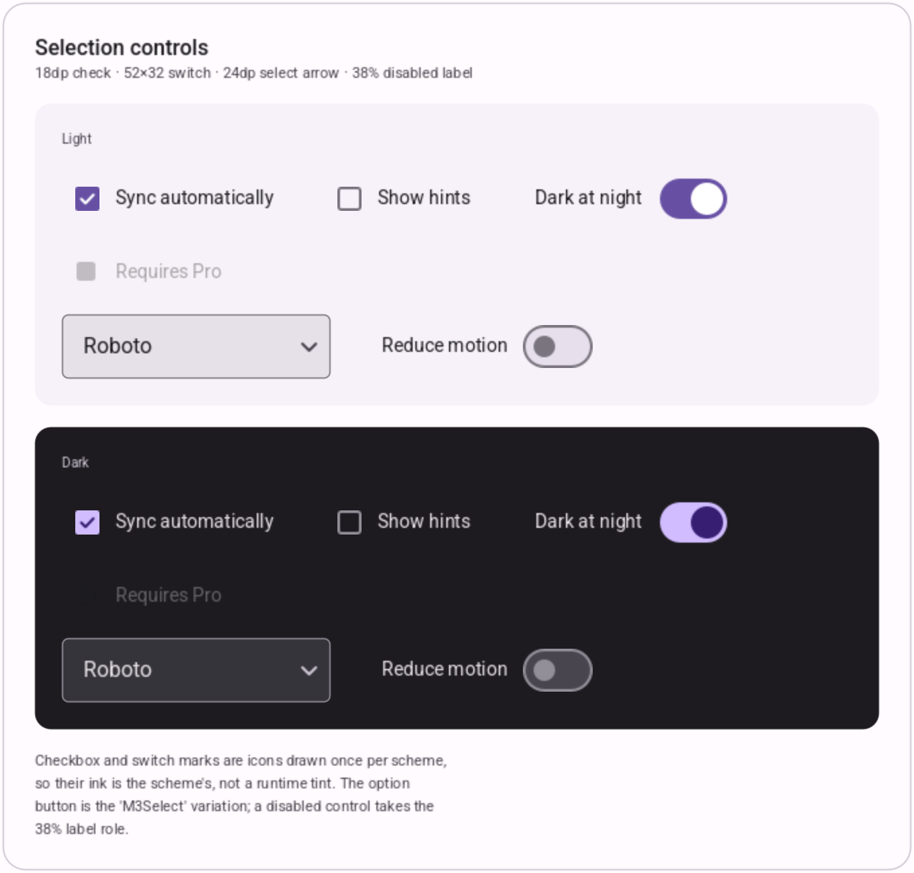
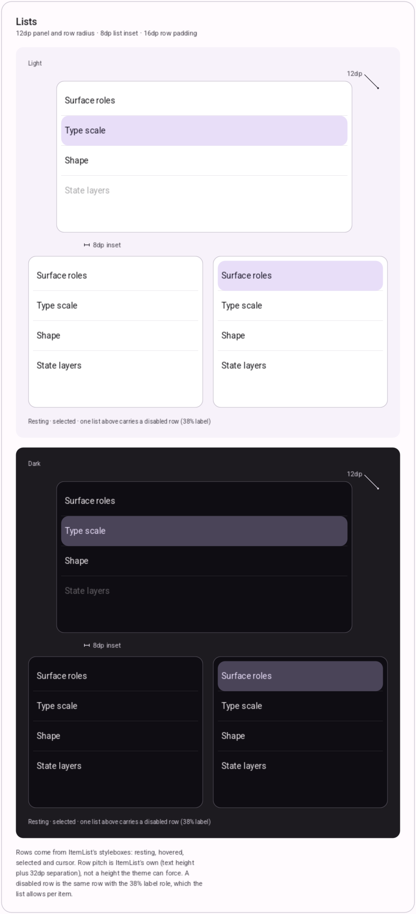
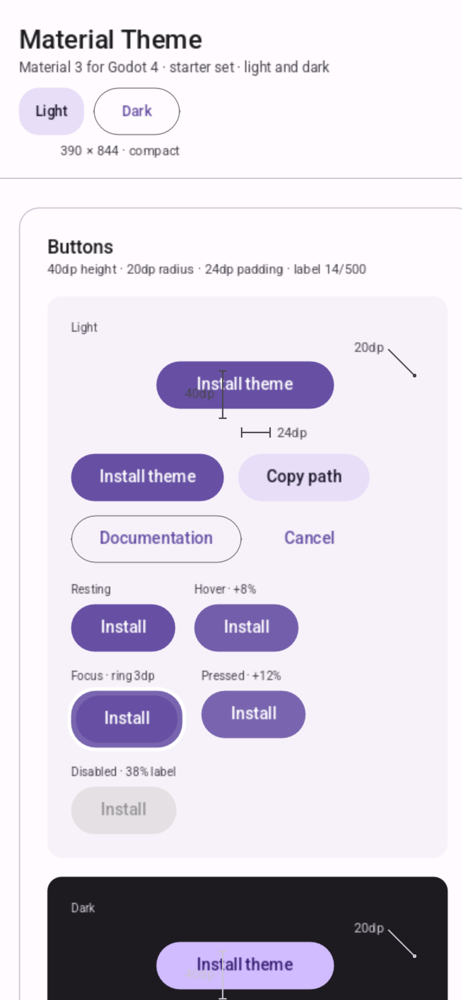

# Material Theme for Godot

A Material 3 theme for Godot 4.7. Two Theme resources, a bundled Roboto, and the
component styling that makes a Godot app look like a current app instead of an
engine demo — buttons, text fields, cards, dialogs and lists, in light and dark,
with hover, focus, pressed and disabled states.

The gallery scene is the argument: one plate per control family, each family's key
measurements called out (button height, radius and padding; field height; card and
dialog radius and padding), the light block above the dark block.

## Screenshots

Captured from the running project at 1440dp, into `docs/screenshots/`. Every plate
shows the light block above the dark block, so one image carries both schemes.





### Buttons

Filled (the default), tonal, outlined and text, plus the five-state strip painted
from the theme's own hover, focus, pressed and disabled styleboxes.



### Text fields

56dp filled field with its 1dp resting underline and 2dp focus underline, the
error variation, a clipped long value, and the multiline `TextEdit`.



### Cards

Filled card on `surface-container-highest` and the outlined variant, 12dp radius
with 16dp padding.



### Dialogs

A 32% scrim, the 28dp panel, a dismiss and a confirm action — and the destructive
variant, which repaints the confirm button in the error role rather than inventing
a red.



### Selection controls

The 18dp check, the 52×32 switch, a disabled control at the 38% label role, and
the `M3Select` option button with its 24dp arrow.



### Lists

`ItemList` with its 12dp panel and row radius, a selected row, a hovered row, and
one row carrying the disabled label.



### Phone

The same scene at 390dp: one column, the header wrapping under the title.



## Use it

Copy `theme/` into your project (or point at this repo), then either

- set **Project Settings → GUI → Theme → Custom** to `res://theme/material_light.tres`, or
- put one theme on a subtree: `some_control.theme = load("res://theme/material_dark.tres")`

Buttons render 40dp and fields 56dp from the theme's published metrics
(`M3Metrics`), which a scene applies with `custom_minimum_size`. Android's 48dp touch
floor sits outside the visual height; wrap a 40dp button in a 48dp container if you
need the full hit area.

Switching schemes at runtime is swapping the resource — every control under it
re-resolves, because the styles read Material's colour roles rather than
hard-coded values.

## What is in the theme

| Type | What you get |
|---|---|
| `Button` | Filled — the default. Type variations: `TonalButton`, `OutlinedButton`, `TextButton` |
| `LineEdit`, `TextEdit` | Filled field: 56dp, 4dp top radius, 1dp resting underline, 2dp primary focus underline |
| `LineEdit` (`M3FieldError`) | Error field: the underline and the hint take the error role |
| `CheckBox`, `CheckButton` | Material 18dp check and the 52×32 switch, drawn per scheme |
| `OptionButton` (`M3Select`) | Outlined select with the dropdown arrow |
| `ItemList` | 12dp panel and row radius, 16dp row padding, hovered and cursor states |
| `PanelContainer` (`M3Card`, `M3CardOutlined`, `M3Dialog`, `M3Plate`) | Card, outlined card, dialog panel, gallery plate |
| `PopupMenu`, `PopupPanel` | Menus with the same surface language |
| `VScrollBar`, `HScrollBar` | Thin grabbers in the palette |

Two components ship as scripts, because Godot has no equivalent control:
`components/card.gd` (`MaterialCard`) and `components/dialog.gd`
(`MaterialDialog` — scrim, 28dp panel, headline, supporting copy, two actions).

Every role also lives in the theme under the `M3Roles` type and the metrics under
`M3Metrics`, so a scene can read the palette instead of repeating hexes:

```gdscript
var primary: Color = theme.get_color("primary", "M3Roles")
var radius: int = theme.get_constant("radius_card", "M3Metrics")
```

## Rebuilding the theme

The `.tres` files are generated from one token table, so the palette, the type
scale and the shapes are edited in one place:

```sh
python3 tools/make_icons.py                 # scheme-coloured checkbox/switch/arrow SVGs
godot --headless --import                   # import the icons and fonts
godot --headless --script res://theme/build_theme.gd
```

`theme/build_theme.gd` holds the Material 3 baseline roles for light and dark,
the state-layer percentages, and the radii. Change a role there, rebuild, and
every control follows.

## The gallery

Open the project and run it: `gallery/gallery.tscn` is the main scene. It reflows
from one column at phone width to two at desktop width, and the Light / Dark
switch re-themes the shell.

Screenshots are produced headlessly, straight out of the scene:

```sh
xvfb-run -a godot -s res://tools/capture.gd              # review captures: 1440 and 390, both schemes
xvfb-run -a godot -s res://tools/capture_components.gd   # docs/screenshots/: one image per family
```

The review captures land in `.impeccable/review/`; the README images land in
`docs/screenshots/`, cropped from the rendered page so the screenshot and the
specimen cannot disagree.

## Scope

Starter set only: buttons, inputs, cards, dialogs, lists. Navigation bar, FAB,
chips, tabs, snackbars, bottom sheets, sliders and top app bars are later work,
not omissions by accident. Dynamic colour (Material You wallpaper extraction) is
out of scope; the schemes are static. Godot 4 has no radio control — a
`CheckBox` in a `ButtonGroup` gives the behaviour with a checkbox mark, and this
kit does not pretend to ship a radio dot.

## Licence

Roboto is bundled under the Apache License 2.0 — see `theme/fonts/LICENSE-Roboto.txt`.
The theme code in this repository is yours to use under the same licence.
